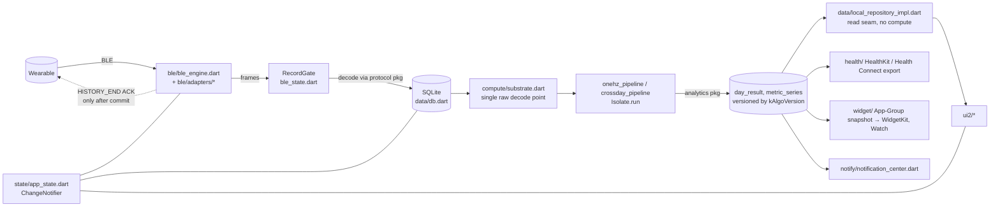
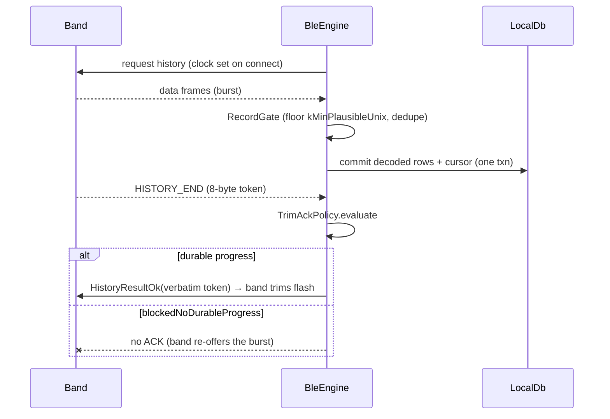
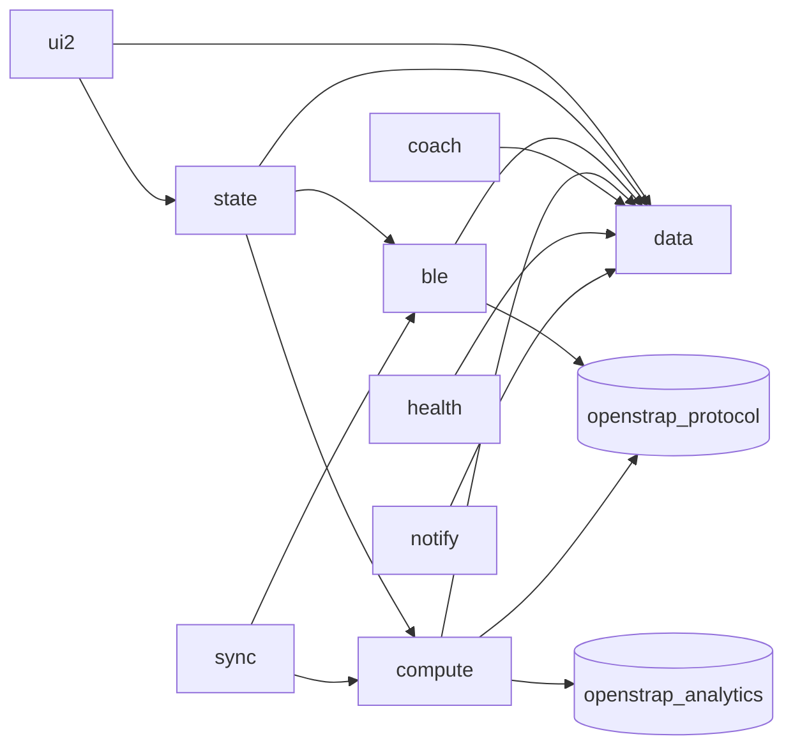

# Architecture (as found)

Baseline: upstream `main` @ `38a83e9` (2026-11-09), app version `0.11.3+78`,
`kAlgoVersion = 120`, `schemaVersion = 58`. Re-check these in source, they move
on every release. AGENTS.md §2 is upstream's own map. This file adds the
flow-level view and doesn't repeat its tables.

## Shape

A single Flutter app (`lib/`, 306 Dart files, ~197k lines) plus two sibling
pure-Dart packages pulled by git SHA:

- `openstrap_protocol`: bytes → records (GATT, framing, CRC, opcodes).
- `openstrap_analytics`: records → metrics (HRV, sleep, readiness, strain).

No server owns user data. `server/report-worker` is an optional upstream
Cloudflare worker for bug reports. Network use is limited to the OTA pointer,
opt-in telemetry, and BYOK LLM calls.

## Layers

| Layer | Where | Notes |
|---|---|---|
| Entry | `lib/main.dart`, `lib/app.dart` | Firebase init in try/catch (optional), telemetry off until consent, `MultiProvider` of ChangeNotifiers, `MaterialApp` + imperative `Navigator` |
| State | `state/app_state.dart` + controllers (`sync_controller`, `derive_coordinator`, `workout_controller`, ...) | `provider` + `ChangeNotifier`. AppState is the BLE↔DB↔UI orchestrator (6k lines) |
| BLE | `ble/ble_engine.dart` (WHOOP), `ble/*_link.dart` + `ble/adapters/*` (Oura, Colmi, Polar, Garmin, Mi Band, Coros, Ultrahuman, Pebble, HRS, Mi scale, thermometer) | `flutter_blue_plus`. Pure, testable policies in `ble_state.dart` |
| Sync | `sync/` | Background/headless entries, `HeadlessSyncGate`, iOS BG tasks/Shortcuts, OTA. Policies in `sync_policy.dart` |
| Persistence | `data/db.dart` | `sqflite`, WAL via `rawQuery`, additive `onUpgrade` ladder + `_repairOpenSchema` on open |
| Compute | `compute/` | Orchestration only. Metric math belongs in the analytics package. Heavy work in `Isolate.run` (17 call sites) |
| UI | `ui2/` | Design system in `theme.dart`/`grammar.dart`, charts via `fl_chart` |
| Platform | `ios/Runner/*.swift`, `ios/OpenStrapWidget`, `ios/OpenStrapWatch Watch App`, `android/` | BG sync scheduler, BLE state restoration, HealthKit sleep writer, Live Activities, App Intents |

## Shared vs platform-specific

Shared: everything in `lib/` except guarded platform branches. iOS-only:
WidgetKit extension, Watch app, Live Activities (16.2+ in code), BLE state
restoration, AccessorySetupKit, Shortcuts. Android-only: foreground/boot
background sync, Health Connect specifics, APK OTA (`ota_update`), notification
listener for band notifications.

## Data model essentials

The durable ledger is `decoded_onehz` (PK `device_id, ts_ms`, INSERT OR
REPLACE) plus `decoded_rr` (beats). Both are pruned `rawRetentionDays` behind
the data edge, never for a non-finalized day (bounded by `_maxRawHoldDays`).
Derived output is the immutable `day_result` (PK `day_id, algo_version`) plus
`metric_series`. AGENTS.md "Storage" has the full rules.

## History sync (WHOOP), the critical path

That `blockedNoDurableProgress` branch is where upstream issue #601 lives (see
TECHNICAL_AUDIT.md).

## Build-time configuration

`--dart-define`s: `COMPANION_URL`, `BACKEND_URL` (both default `''` = off) and
`ENABLE_HEALTH_DATA_CONTRIBUTION` (default `false`). iOS identifiers come from
`ios/Config/Signing.defaults.xcconfig` (`com.example.openstrapEdge`,
`group.com.example.openstrap`), overridable via a gitignored
`Signing.xcconfig`. Firebase is optional at build time: a dummy
`lib/firebase_options.dart` is committed and an Xcode phase writes a
placeholder `GoogleService-Info.plist`.

## Mapa de módulos (ampliación 2026-11-12, commit `15d791a0`)

Tamaños medidos con `wc -l` (cambian en cada versión: vuelve a medir).

| Carpeta `lib/` | Archivos | Líneas | Responsabilidad | Leer antes de tocar |
|---|---:|---:|---|---|
| `ui2/` | 81+ | ~72 k | Pantallas y sistema de diseño | `lib/ui2/README.md`, UI_UX_AUDIT.md |
| `data/` | 27 | ~30 k | `LocalDb`, lectura para la UI, archivo, exportación | DATA_MODEL.md, DATA_DICTIONARY.md |
| `ble/` | 38 | ~28 k | Motor BLE WHOOP + adaptadores de otros dispositivos | WHOOP_INTEGRATION.md, AGENTS.md §3.1–2 |
| `compute/` | 35 | ~26 k | Orquestación de la analítica (sin fórmulas) | ALGORITHMS.md, DATA_FLOW.md |
| `state/` | 15 | ~11 k | `AppState` y controladores | AGENTS.md §4.3, §4.5 |
| `coach/` | 9 | ~4,7 k | Coach determinista y LLM sobre vistas `v_*` | SECURITY.md |
| `health/` | 10 | ~4,4 k | HealthKit / Health Connect | FEATURES.md §7 |
| `notify/` | 13 | ~4,3 k | Emisor único de notificaciones | AGENTS.md §4.6 |
| `sync/` | 15 | ~3,7 k | Segundo plano, BG tasks, OTA | WHOOP_INTEGRATION.md §2 |
| `import/` | 9 | ~4 k | Backups, WHOOP oficial, Hevy, CSV | research/DATA_SOURCES.md |
| `ai/`, `gps/`, `ecg/`, `widget/`, `stress/`, `gestures/`, `platform/`, `telemetry/`… | — | ~8 k | Funciones acotadas | FEATURES.md |

Dependencias internas principales:

Regla: `ui2` no calcula (lee de `data/local_repository_impl.dart`), `compute`
no dibuja, y las fórmulas están en `openstrap_analytics`.
