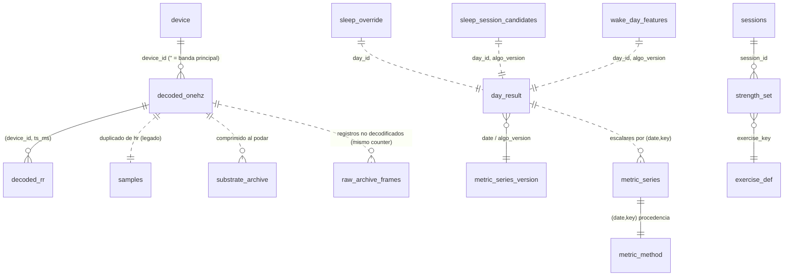

# Auditoría de la base de datos (exportación real)

> Fecha: 2026-11-12 · Fuente: exportación SQLite de la app (`schemaVersion 58`,
> `kAlgoVersion 120`, app `0.11.3+78`), banda WHOOP 5.0 (`device_family = gen5`).
> Análisis hecho **en local, en solo lectura**, sobre una copia. Ningún valor
> biométrico individual aparece aquí: solo recuentos, porcentajes y errores
> relativos. Scripts en `docs/development/analysis/` (ver DATA_ANALYSIS.md).

Documentos hermanos: DATA_QUALITY.md (calidad), DATA_DICTIONARY.md (campos),
DATA_ANALYSIS.md (experimentos), DATA_OPPORTUNITIES.md (qué se puede construir).
El esquema lo define `LocalDb` en `lib/data/db.dart` (escalera `onUpgrade`,
`_repairOpenSchema`).

## 1. Resumen ejecutivo

| Pregunta | Respuesta |
|---|---|
| Tablas en el esquema | 70 (incl. `sqlite_sequence`). 41 vacías en esta exportación |
| Tamaño | 79 MB (19 315 páginas de 4 KB, 0 páginas libres) |
| Histórico 1 Hz "vivo" | 4 días locales (2 completos de 24 h, 2 parciales) |
| Histórico comprimido (`substrate_archive`) | 4 días UTC adicionales, parciales |
| Días con resultado derivado (`day_result` v120) | 8 (3 con noche detectada) |
| Noches con HRV/RHR/sueño | **3** |
| ¿Hay datos suficientes para baselines? | **No.** Readiness exige 14 noches, strain 3 días de nivel de reposo, CTL/ATL 14 días |
| Integridad de sincronización | Buena: 4 648 lotes `acked`, 0 errores, 0 cuarentenas |

**Conclusión principal:** el modelo de datos es sólido y versionado, pero el
histórico real es demasiado corto para validar estadísticamente recovery,
tendencias o correlaciones. Lo que sí se puede validar hoy (y se ha hecho) es
la **reproducibilidad** de RHR, RMSSD, TRIMP y nivel de reposo a partir de los
datos crudos: coinciden con lo almacenado (DATA_ANALYSIS.md §2).

## 2. Mapa de tablas por dominio

Las relaciones son **lógicas**: SQLite no declara `FOREIGN KEY` en ninguna
tabla. La integridad la mantiene el código (`LocalDb`).

| Dominio | Tablas con datos (filas) | Tablas vacías relevantes |
|---|---|---|
| Ledger crudo | `decoded_onehz` (275 918), `decoded_rr` (152 896), `samples` (275 918), `raw_archive_frames` (11 299), `substrate_archive` (4) | `ecg_raw_packet`, `external_hr`, `observation`, `vendor_sleep_epoch` |
| Eventos de banda | `band_events` (3 883), `events` (3 851), `band_battery` (1 043), `band_backlog` (1 072) | — |
| Sincronización | `sync_ledger` (4 649), `sync_cursor` (6), `device_coverage` (368), `device` (1) | `sync_quarantine`, `live_coverage` |
| Derivado | `day_result` (12), `metric_series` (336), `metric_method` (336), `metric_series_version` (8), `baselines` (6), `sleep_session_candidates` (7), `wake_day_features` (7), `compute_freshness` (14) | `derived_day`, `derive_fingerprint`, `compute_jobs` |
| Entrenamiento | `sessions` (25), `strength_set` (503), `exercise_def` (11) | `workout_route`, `workout_split`, `imported_workout`, `live_workout_tally` |
| Correcciones del usuario | `sleep_override` (3), `activity_suggestions` (2) | `sleep_nap` |
| Registro manual | — | `journal*`, `food_*`, `med_*`, `lab_*`, `cycle_*`, `breathing_session` |
| Notificaciones | `notif_fired` (3), `notif_slots` (3) | `notifications` |

## 3. Claves, índices y unicidad

- Ledger 1 Hz: PK `(device_id, ts_ms)` con `INSERT OR REPLACE` (invariante 2 de
  AGENTS.md). Verificado en datos: 275 918 filas, 275 918 `ts_ms` distintos.
- `decoded_rr`: PK `(device_id, ts_ms, beat_index)`; hasta 4 latidos por segundo
  (`beat_index` 0..3).
- Derivado inmutable por versión: `day_result` PK `(day_id, algo_version)`.
  En la exportación conviven filas v113 y v120 para los mismos días (5 días
  tienen ambas). Es el diseño (las filas viejas no se borran), pero el lector
  debe elegir siempre la versión más alta.
- `metric_series` PK `(date, key)` con REPLACE: **no guarda versión por fila**;
  la versión vive en `metric_series_version(date)`. Un día solo tiene la serie
  de una versión.
- Índices secundarios: 33 (`idx_*`). Los más pesados son
  `idx_decoded_onehz_rects` (5 MB) e `idx_samples_ts` (3,6 MB).

## 4. Peso en disco

| Objeto | MB | % |
|---|---:|---:|
| `decoded_onehz` | 34,6 | 43,8 |
| `samples` + sus 2 índices | 15,5 | 19,6 |
| `decoded_rr` + índices | 11,6 | 14,7 |
| índices de `decoded_onehz` | 9,4 | 11,9 |
| `raw_archive_frames` | 1,7 | 2,1 |
| `substrate_archive` | 0,8 | 1,0 |

Hallazgos:

- **DB-01 `samples` duplica `decoded_onehz.hr`** (99,9996 % de filas idénticas;
  las 157 diferencias son `NULL` en 1 Hz frente a `0` en `samples`). Ocupa ~20 %
  de la base. Solo se lee como *fallback* en `LocalDb.samplesInRange` y
  `LocalDb.latestSample` cuando `decoded_onehz` está vacío. Es legado de antes de
  v19. No se propone borrarlo en el fork (tabla de upstream, ver DECISIONS.md
  D-07); sí abrir un issue upstream.
- **DB-02 `raw_archive_frames` crece sin poda para gen5.** Los 11 299 frames
  son `undecodable_rec_v26` (tipo 47, revisión 26). La poda documentada
  (`_thinRawArchiveVia`) solo afecta a `undecodable_rec_v20`. El 80 % comparte
  `counter` con una fila de `decoded_onehz`: no son segundos perdidos, son el
  **registro gemelo PIP** (ventana de 25 muestras ópticas) que el paquete
  `openstrap_protocol` ya sabe parsear (`gen5_records.dart`, sección v26) y la
  app no consume. ~0,4 MB/día.
- La retención de crudo vivo es `rawRetentionDays = 5`
  (`lib/compute/derivation_engine.dart`). Lo podado pasa a `substrate_archive`
  (~10× más pequeño). La política está en `compute_freshness`:
  `substrate_archive_policy.keep_days = 365` en este dispositivo (el defecto de
  código es 90, `SubstrateArchivePolicy.defaults`).

## 5. Modelo real frente al código

| Aspecto | Código | Datos reales | Estado |
|---|---|---|---|
| Columnas gen5 de 1 Hz | `skin_temp_c`, `temp_ch2_c`, `temp_ch3_c`, `signal_quality_logvar`, `dyn_accel_g`, `band_sleep_state`, `hr_alt` | todas pobladas al 100 % | OK |
| Columnas gen4 | `skin_temp_raw`, `spo2_red_raw`, `spo2_ir_raw`, `ambient_raw`, `on_wrist`, `hr_valid` | 100 % `NULL` en gen5 | Esperado: la banda no las emite en este formato |
| `source` en 1 Hz y RR | multi-dispositivo | 100 % `NULL` | Esperado (`NULL` = banda principal) |
| Readiness | `day_result.readiness` | `NULL` en los 12 días | Correcto: abstiene con `need_baseline:have=1..2,need=14` |
| Strain | `metric_series.strain` | `NULL` en los 8 días; `trimp` presente en 3 | Correcto: abstiene con `need_baseline:have=1,need=3` |
| `sessions.strain` | se rellena al cerrar sesión | `NULL` en la única sesión con traza | Pendiente de `strain_backfill.dart` cuando exista nivel de reposo; verificar |
| Unidades de tiempo | mezcla s / ms | ver DATA_DICTIONARY.md §1 | Riesgo de bugs al consultar a mano |

## 6. Estructuras inconsistentes o frágiles

- **DB-03 Unidades temporales mezcladas.** `rec_ts`, `ts`, `start_ts`,
  `device.first_seen` en **segundos**; `ts_ms`, `captured_at`, `created_at`,
  `computed_at`, `sync_ledger.*_at` en **milisegundos**. Las consultas
  analíticas deben normalizar. (Al leer `device.first_seen` como ms sale 1970.)
- **DB-04 `metric_method` no informa del método.** Todas las filas dicen
  `method = family = 'hr_1hz'`, `class = 'ours'`. Es procedencia de *fuente*
  (banda vs. vendor), no del algoritmo; el nombre induce a error.
- **DB-05 JSON como contrato.** `day_result.payload_json` (75–82 KB por día
  completo) y `baselines.payload_json` son la fuente de verdad de casi todas
  las métricas, sin esquema declarado. Su forma está en
  `lib/compute/onehz_pipeline.dart` y `crossday_pipeline.dart`. Documentada en
  DATA_DICTIONARY.md §4.
- Filas `day_result` v113 no finalizadas conviven con v120 finalizadas
  (2026-11-09). Inofensivo si el lector toma la versión máxima.

## 7. ¿Sirve el modelo para lo que se quiere construir?

| Capacidad | ¿Lo permite hoy? | Comentario |
|---|---|---|
| Histórico biométrico granular | Sí, 5 días vivos + archivo comprimido (365 d aquí) | El archivo **no se re-deriva todavía** (`substrate_archive.dart`: "WRITE SIDE ONLY") |
| Métricas derivadas | Sí (`metric_series`, ~42 claves/día) | |
| Versiones de algoritmo | Sí (`day_result` por `algo_version`) | `metric_series` solo guarda la última |
| Recalcular histórico | Parcial | Solo días con sustrato vivo. Ver DATA_OPPORTUNITIES.md O-01 |
| Baselines individuales | Sí (`baselines`: `rolling`, `rolling_artifact`, `sleep_user_profile`, `crossday`) | Una sola fila por clave: no hay historial de baselines |
| Hábitos manuales | Sí (`journal`, `journal_metric`, `journal_field_def`) | Vacío: no se está registrando nada |
| Recomendaciones y su resultado | No | No hay tabla de recomendaciones emitidas ni de cumplimiento |
| Análisis longitudinal eficiente | Sí (`metric_series` es estrecha y por fecha) | |

Propuestas concretas en IMPROVEMENT_BACKLOG.md (DATA-*).
