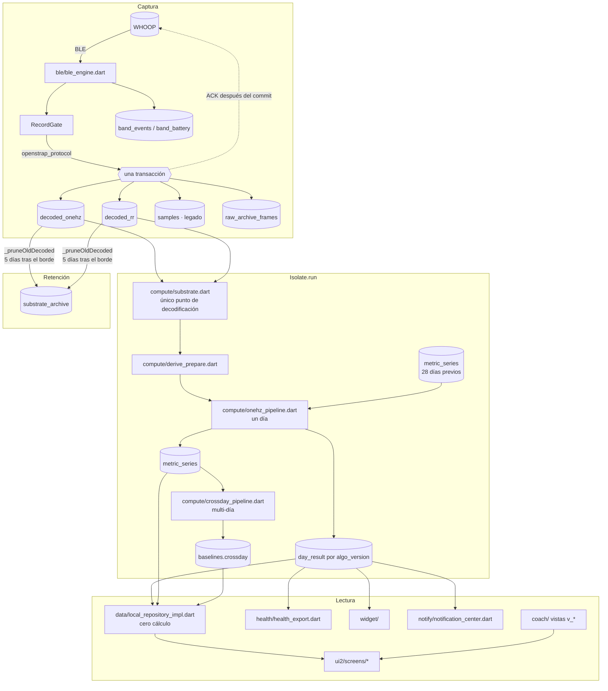
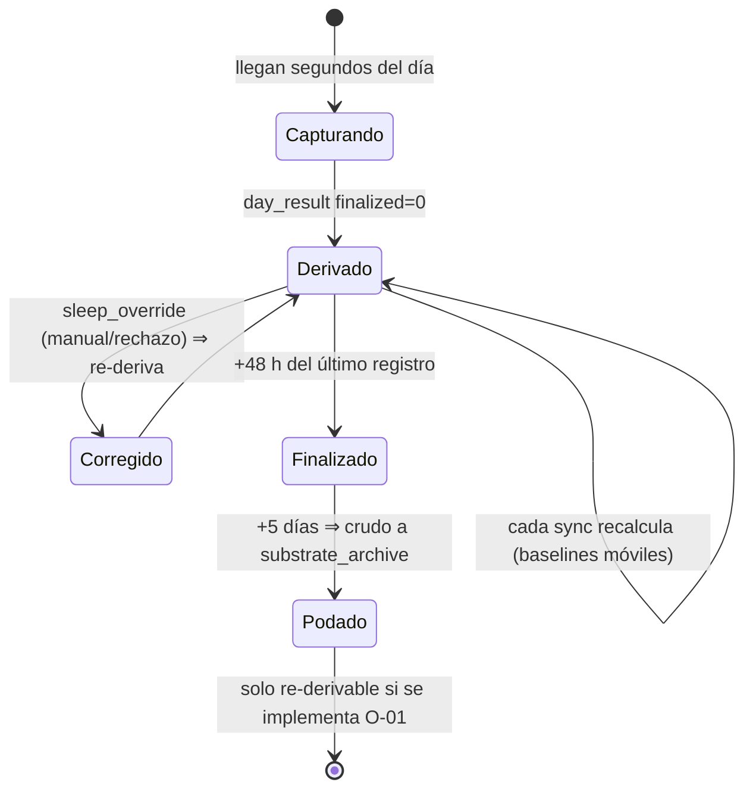

# Flujo de datos: de la banda a la pantalla

> Fecha: 2026-11-12. Contrastado con el código y con la exportación real.
> Línea a línea, los nombres de símbolos son estables; los números de línea no
> (AGENTS.md cabecera). Busca por símbolo.

## 1. Vista general

## 2. Paso a paso

1. **Ingesta** (`ble_engine.dart`): cada ráfaga se decodifica y se guarda en
   una transacción con su cursor; solo entonces se envía el ACK.
2. **Programación** (`derive_scheduler.dart`): durante una descarga se encola
   la intención en `compute_jobs` y se espera a que la captura se calme.
3. **Preparación** (`derive_prepare.dart`): lee 1 Hz + RR del día (desde el
   mediodía anterior), aplica la precedencia de ventana de sueño
   (override > vendor > auto > fallback) y adjunta el histórico de baselines
   **excluyendo el propio día** (`_attachHistory`).
4. **Pipeline diario** (`onehz_pipeline.dart`, dentro de `Isolate.run`):
   sueño, HRV, RHR, respiración, temperatura, estrés, zonas, TRIMP, strain,
   readiness, calorías, actividad. Devuelve el `payload` y los escalares.
5. **Persistencia**: `day_result` (inmutable por versión) + `metric_series`
   (REPLACE) + `metric_series_version` + `metric_method`.
6. **Multi‑día** (`crossday_pipeline.dart`): enfermedad, anomalía, CTL/ATL,
   regularidad, cronotipo, deuda y necesidad de sueño, percentiles. Se guarda
   en `baselines` (`crossday`, `crossday_input`).
7. **Finalización**: un día se bloquea 48 h después de su último registro
   (`_finalizationSec`). Antes de eso se recalcula en cada sincronización.
8. **Retención**: a los 5 días tras el borde de datos (`rawRetentionDays`), el
   crudo se poda a medianoche local y se archiva comprimido. Nunca se poda un
   día no finalizado, salvo el tope de `_maxRawHoldDays`.
9. **Lectura** (`local_repository_impl.dart`): transforma filas en las formas
   que esperan las pantallas. No calcula.

## 3. Ciclo de vida de un día (observado en la exportación)

En la exportación: 4 días finalizados con v120, 3 no finalizados (los
recientes), 1 día v113 no finalizado sobrante.

## 4. Puntos frágiles del flujo

| Punto | Riesgo | Referencia |
|---|---|---|
| Re‑derivación repetida con baseline móvil | Deriva del score durante el día | AGENTS.md §4.2 (mitigado) |
| `metricSeries(limit: n)` devuelve los **más antiguos** | Baselines equivocados si se usa mal | AGENTS.md §4.2 |
| Días podados no re‑derivables | Un cambio de algoritmo no llega al histórico | O‑01 |
| Serie densa de TRIMP | No llevar = descansar | Q‑05 / ALG‑L1 |
