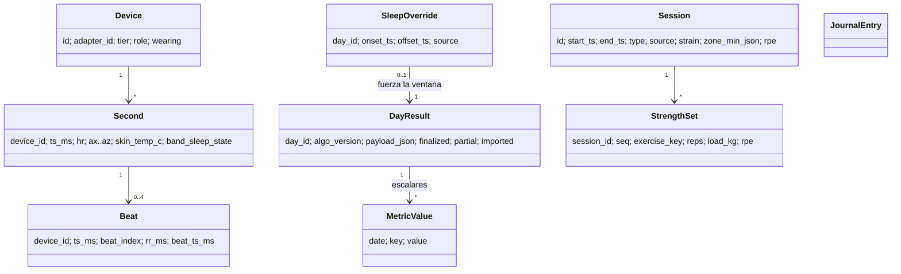

# Modelo de datos

> Fecha: 2026-11-12 · `schemaVersion 58`. El DDL vive en `lib/data/db.dart`
> (`LocalDb`). Campo a campo: DATA_DICTIONARY.md. Estado real de la base:
> DATABASE_AUDIT.md.

## 1. Tres capas

| Capa | Tablas | Mutabilidad | Retención |
|---|---|---|---|
| **Crudo** | `decoded_onehz`, `decoded_rr`, `samples`, `events`, `band_events`, `band_battery`, `raw_archive_frames` | INSERT OR REPLACE por segundo | 5 días vivos; luego `substrate_archive` |
| **Derivado** | `day_result`, `metric_series`, `metric_series_version`, `metric_method`, `baselines`, `sleep_session_candidates`, `wake_day_features` | `day_result` inmutable por versión; el resto REPLACE | Indefinida |
| **Usuario** | `sessions`, `strength_set`, `sleep_override`, `sleep_nap`, `journal*`, `food_*`, `med_*`, `lab_*`, `cycle_*`, `activity_suggestions` | Edición del usuario | Indefinida |

Más tablas de operación: `sync_ledger`, `sync_cursor`, `compute_jobs`,
`compute_freshness`, `notif_*`, `device*`.

## 2. Entidades y relaciones

Una **sesión de sueño** no es una tabla: vive en
`day_result.payload_json.sleep` y en `sleep_session_candidates`. Una
**recuperación** tampoco: es `clinical.readiness_composite` + `scalars.readiness`.
Los **baselines del día** están en `payload_json.baselines` (por día) y el
estado actual en la tabla `baselines` (una fila por clave).

## 3. Decisiones del modelo que conviene conservar

1. **Ledger 1 Hz como sistema de registro** y todo lo demás recalculable.
2. **Derivado inmutable por versión de algoritmo**: permite auditar qué
   versión produjo cada número.
3. **Ausencia = NULL**, con nota de por qué en el payload.
4. **Correcciones del usuario como tablas aparte** (`sleep_override`) que el
   derivador respeta, en vez de editar resultados.
5. **Días importados marcados** (`imported`) y excluidos de baselines.

## 4. Huecos para los objetivos del producto

| Necesidad | Hoy | Propuesta mínima (justificada) |
|---|---|---|
| Recalcular histórico tras cambiar un algoritmo | Solo días vivos | Re‑derivar desde `substrate_archive` (O‑01); **sin tabla nueva** |
| Comparar versiones de una métrica | `metric_series` solo guarda la última | Leer `day_result` de ambas versiones (ya existen); no hace falta tabla |
| Historial de baselines | En cada `payload_json.baselines` | Documentar y leer de ahí (ALG‑T2) |
| Registrar recomendaciones y su resultado | No existe | Tabla `recommendation_log(day_id, kind, payload_json, shown_at, followed, outcome_json)` solo cuando exista el motor de recomendaciones (FI‑E4). Migración aditiva |
| Experimentos personales | No existe | `experiment(id, hypothesis, metric_key, start, end, arms_json)` + reutilizar `journal` para la exposición diaria (FI‑F2) |
| Procedencia de correcciones de sueño | "I'm awake" y edición manual comparten `source = 'manual'` | Nuevo valor `source = 'awake_tap'` en `sleep_override` (sin cambio de esquema: es un TEXT). Las filas antiguas se reconocen por `offset_ts == created_at` (DATA‑06). **Descartado:** se usa la regla `source='manual' AND abs(created_at − offset_ts) ≤ 60`, con sus límites (AUDIT_VERIFICATION.md §2.6) |
| Bienestar subjetivo diario | `journal_metric` + `journal_field_def` existen | Reutilizar: definir campos fijos "energía", "agujetas", "sueño percibido" |

Regla: cualquier tabla nueva es una migración **aditiva e idempotente** en la
escalera `onUpgrade` + `_repairOpenSchema` (invariante 11), con test de
migración, y sube `schemaVersion`.
