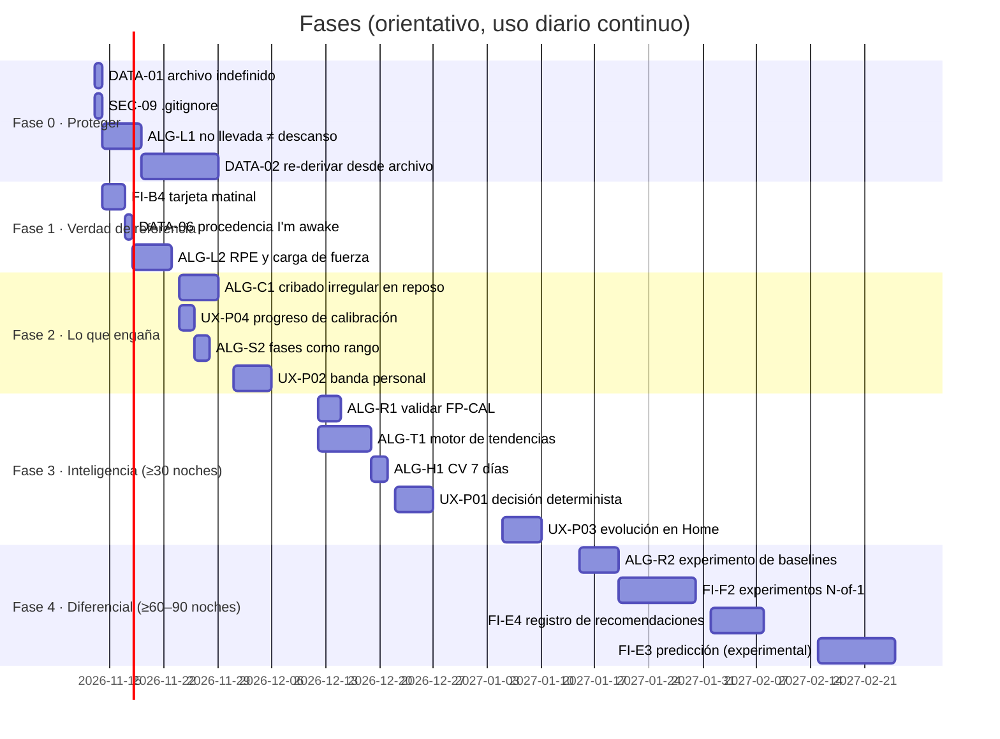
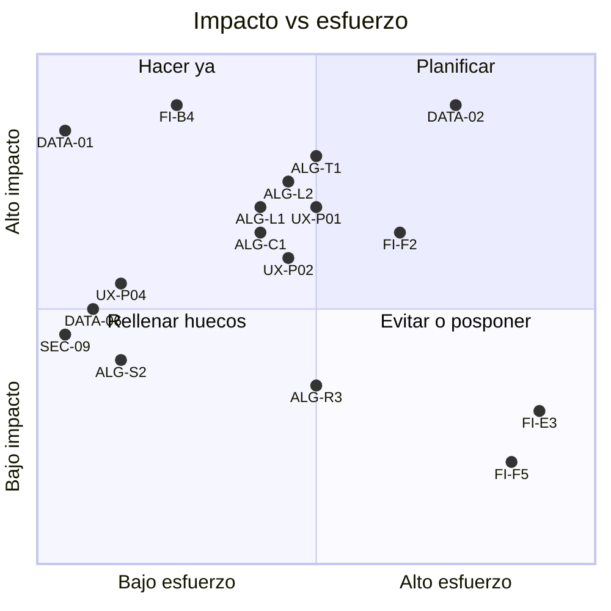

# Hoja de ruta

> Fecha: 2026-11-12 · commit `15d791a0`. Especificación de cada tarea en
> IMPROVEMENT_BACKLOG.md; estado vivo en PLANNING.md. Criterios: impacto en el
> usuario, valor funcional, esfuerzo, riesgo técnico y **disponibilidad de
> datos** (hoy: 3 noches).

## Principio rector

El cuello de botella no es el código, es el **histórico**. Por eso la
secuencia es: (1) no perder datos, (2) empezar a capturar la verdad de
referencia (cómo te sientes, cuándo te despiertas, RPE), (3) arreglar lo que
engaña, (4) construir inteligencia cuando haya 30–90 noches para validarla.

## Fases

| Fase | Objetivo | Condición de salida |
|---|---|---|
| 0 · Proteger | Que ningún día se pierda para futuros algoritmos | Archivo indefinido; carga sin ceros inventados; re‑derivación desde archivo con test de ida y vuelta |
| 1 · Verdad de referencia | Capturar lo que la banda no sabe | 14 días seguidos con tarjeta matinal y RPE |
| 2 · Lo que engaña | Quitar alarmas y precisión falsas | Tasa de cribado irregular en días solo diurnos = 0 con fixture; fases con rango |
| 3 · Inteligencia | Tendencias y decisión explicable | Concordancia FP‑CAL medida; tendencias con < 5 % de falsos positivos en sintético |
| 4 · Diferencial | Aprender de ti | Primer experimento N‑of‑1 cerrado con resultado |

## Matriz impacto / esfuerzo

## Riesgos de la hoja de ruta

| Riesgo | Mitigación |
|---|---|
| Cambios en hotspots (`db.dart`, `derivation_engine.dart`) chocan con upstream | Diffs mínimos, ramas por tarea, PR upstream si les sirve |
| Sin toolchain en la sesión de agente | Tests en tu PC (`--concurrency=1`); nunca afirmar que se ejecutaron |
| Un cambio de algoritmo sin bump deja días incoherentes | Checklist de DEVELOPMENT_GUIDE §3 |
| Se dejan de usar la tarjeta matinal o el RPE | Mantenerlos en ≤ 10 s; medir cumplimiento y decir cuándo falta |
| Firmware actualizado por la app oficial | No instalarla con esta banda |
