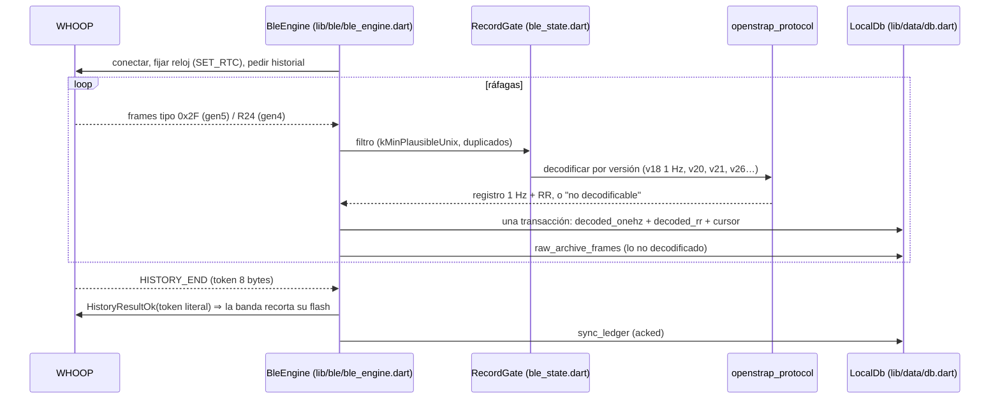

# Integración con WHOOP

> Fecha: 2026-11-12 · Verificado contra `lib/ble/`, `lib/sync/`,
> `openstrap_protocol` @ `b4fde6a` y la exportación real (WHOOP 5.0, firmware
> 50.38.1.0). Complementa ARCHITECTURE.md ("History sync") y
> `docs/isgen5-inventory.md` (upstream).

## 1. Cómo se obtienen los datos

No hay nube de WHOOP de por medio. La app habla BLE con la banda, le pide su
**historial en flash** y lo guarda en SQLite. La banda solo borra (trim) su
flash cuando la app le devuelve el *token* `HISTORY_END` **después** de haber
guardado (invariante 1).

Detalles:

- **Formato gen5:** paquete tipo 47 (0x2F) con `hist_version` 18, 20, 21, 26
  (`gen5_records.dart`). v18 es el registro por segundo (FC, RR, acelerómetro,
  temperatura, contador de pasos, estado de sueño). v26 es la ventana óptica
  PIP (episodios de 40 s); la app la archiva sin consumirla.
- **Eventos:** `band_events` (35 tipos vistos: batería, `WRIST_ON/OFF`,
  `DOUBLE_TAP`, alarma, `HIGH_FREQ_SYNC_*`…).
- **Comandos peligrosos** (borrar flash, reiniciar, firmware) nunca se envían
  automáticamente (invariante 15).

## 2. Mecanismos de sincronización

| Mecanismo | Código | Cuándo | Qué hace |
|---|---|---|---|
| Conexión viva en primer plano | `lib/state/app_state.dart`, `lib/state/sync_controller.dart` | App abierta | Mantiene conexión, drena historial, stream en vivo |
| Restauración BLE iOS | `lib/sync/background_sync.dart` (vía `ios_ble_restore.dart`) | iOS relanza la app al reaparecer la banda | Drenado sin UI |
| BGTask iOS | `lib/sync/ios_bg_task.dart` + `BgSyncScheduler.swift` | Cuando iOS quiere | Refresh: solo sync. Processing: sync + derivación pesada |
| Atajo "Sync Data" | `lib/sync/ios_shortcut_sync.dart` | Manual o automatización de Atajos | Sync bajo demanda |
| Android | foreground service + arranque (`android_boot_signal.dart`) | Siempre | Sin limitación de iOS |
| Serialización | `HeadlessSyncGate.tryRun` (`lib/sync/headless_gate.dart`) | Siempre | Si ya hay sync, se salta (invariante 12) |
| Derivación | `lib/compute/derive_scheduler.dart` + `compute_jobs` | Tras asentarse la captura | Cola duradera; reanuda tras reinicio |

**iOS sin cuenta de desarrollador de pago** (tu caso, sideload): la firma
caduca cada 7 días (aviso FP‑01 ya implementado) y las App Groups (widget,
Live Activity) pueden no funcionar.

## 3. Qué se almacena, con qué granularidad

Ver DATA_DICTIONARY.md. Resumen gen5: 1 registro/segundo (FC, 3 ejes,
temperatura en °C, contador de pasos, estado de sueño, calidad de señal) y
hasta 4 latidos RR por segundo. Retención viva 5 días (`rawRetentionDays`),
luego archivo comprimido (`substrate_archive`, política configurable, 365 días
en tu dispositivo).

## 4. Datos obtenidos, derivados, estimados y no disponibles

Tabla completa en research/BIOMETRIC_METRICS.md. Clave:

- **Obtenidos de la banda:** FC 1 Hz, RR, acelerómetro, temperatura de piel,
  contador de movimiento, clase de actividad, estado de sueño de la banda,
  batería y eventos.
- **Derivados en el móvil:** RHR, HRV, frecuencia respiratoria, sueño, strain,
  readiness, estrés, calorías.
- **No disponibles:** SpO2 en gen5, ECG en 5.0, presión arterial, la "carga
  muscular" y los scores oficiales de WHOOP.

## 5. Qué se pierde o no se aprovecha

| Dato | Estado | Propuesta |
|---|---|---|
| Registros PIP v26 (PPG) | Archivados como "no decodificables", sin poda | Decidir: consumir (investigación) o podar (DATA‑02) |
| `band_sleep_state` | Solo para recortar el final cuando la banda pasa a despierto | Útil para el inicio; **no** para el final (sigue en "dormido" tras "I'm awake") |
| `signal_quality_logvar` | Casi sin uso | Máscara de calidad para cribados (ALG‑C1) |
| `hr_alt`, `temp_ch2_c`, `temp_ch3_c` | Guardados, sin uso, semántica no verificada | Investigar en el repo `protocol` |
| Temperatura gen5 en readiness | Rechazada siempre | ALG‑R3 |
| Stream en vivo | Nunca se persiste (por diseño) | Mantener |
| Eventos `DOUBLE_TAP` | Registrados | Usar como marcador rápido ("anotar ahora") — FI‑D3 |

## 6. Limitaciones por usar WHOOP sin suscripción

| Limitación | Consecuencia | Mitigación |
|---|---|---|
| Sin algoritmos oficiales | Todos los scores son propios y no comparables 1:1 | Transparencia (ALGORITHMS.md); validar con tu sensación (FI‑E5) |
| Sin SpO2 / carga muscular / BP | Menos señales | No inventarlas; usar sRPE para fuerza |
| Firmware congelado | Riesgo si la app oficial actualiza | No usar la app oficial con esta banda |
| Sin nube | Backup y migración son tu responsabilidad | Backups cifrados programados (ya existen) |
| Sin histórico previo | Arranque en frío largo | Archivo indefinido + importar export oficial como referencia |
